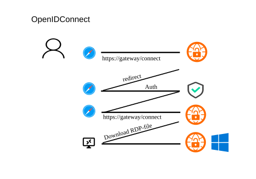

# OpenID Connect Authentication



RDPGW supports OpenID Connect authentication for integration with identity providers like Keycloak, Okta, Google, Azure, Apple, or Facebook.

## Configuration

To use OpenID Connect, ensure you have properly configured your OpenID Connect provider with a client ID and secret. The client ID and secret authenticate the gateway to the OpenID Connect provider. The provider authenticates the user and provides the gateway with a token, which generates a PAA token for RDP host connections.

```yaml
Server:
  Authentication:
    - openid
OpenId:
  ProviderUrl: https://<provider_url>
  ClientId: <your_client_id>
  ClientSecret: <your_client_secret>
Caps:
  TokenAuth: true
```

### Username claim

The gateway takes the username from the ID token. By default it uses the first
of these claims that is present: `preferred_username`, `unique_name`, `upn`,
`username`. To use a different claim, set `UsernameClaim`:

```yaml
OpenId:
  UsernameClaim: email
```

When `UsernameClaim` is set, only that claim is used. The `email` claim is only
accepted when the provider sends `email_verified: true`, because many providers
let users change their email address.

The username selects the hosts a user can connect to (`{{ preferred_username }}`
in `Server.Hosts`) and becomes the RDP username. To turn an email address into
a Windows login, use `Client.SplitUserDomain` or `Client.UsernameTemplate`.

## Authentication Flow

1. User navigates to `https://your-gateway/connect`
2. Gateway redirects to OpenID Connect provider for authentication
3. User authenticates with the provider (supports MFA)
4. Provider redirects back to gateway with authentication token
5. Gateway validates token and generates RDP file with temporary credentials
6. User downloads RDP file and connects using remote desktop client

## Multi-Factor Authentication (MFA)

RDPGW provides multi-factor authentication out of the box with OpenID Connect integration. Configure MFA in your identity provider to enhance security.

## Provider Examples

### Keycloak
```yaml
OpenId:
  ProviderUrl: https://keycloak.example.com/auth/realms/your-realm
  ClientId: rdpgw
  ClientSecret: your-keycloak-secret
```

### Azure AD
```yaml
OpenId:
  ProviderUrl: https://login.microsoftonline.com/{tenant-id}/v2.0
  ClientId: your-azure-app-id
  ClientSecret: your-azure-secret
```

### Google
```yaml
OpenId:
  ProviderUrl: https://accounts.google.com
  ClientId: your-google-client-id.googleusercontent.com
  ClientSecret: your-google-secret
  # Google does not send preferred_username, only email
  UsernameClaim: email
```

The gateway accepts every account that the provider authenticates. With an
External OAuth consent screen that is any Google account, so use an Internal app
(Google Workspace) to limit sign-in to your organization.

## Security Considerations

- Always use HTTPS for production deployments
- Store client secrets securely and rotate them regularly
- Configure appropriate scopes and claims in your provider
- Enable MFA in your identity provider for enhanced security
- Set appropriate session timeouts in both gateway and provider

## Troubleshooting

- Ensure `ProviderUrl` is accessible from the gateway
- Verify redirect URI is configured in your provider (usually `https://your-gateway/callback`)
- Check that required scopes (openid, profile, email) are configured
- Validate that the provider's certificate is trusted by the gateway
